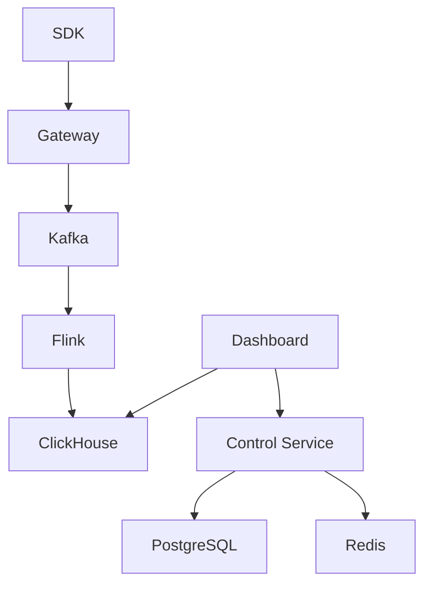

<script setup lang="ts">
// 首次访问按浏览器语言选择文档语言（vitepress 无此能力，GitHub Pages 不支持 _redirects）
// 优先级：localStorage 手动选择 > navigator.language > 保持当前 locale
import { onBeforeMount } from 'vue'
const KEY = 'oddsmaker-lang-auto-picked'
const BASE = '/oddsmaker/'
const ROOT_PATH = BASE
const ZH_PATH = BASE + 'zh/'
onBeforeMount(() => {{
  if (typeof window === 'undefined') return
  const p = window.location.pathname
  if (p !== ROOT_PATH && p !== ROOT_PATH.slice(0, -1)) return
  const picked = localStorage.getItem(KEY)
  if (picked) {{ if (picked !== p) window.location.replace(picked); return }}
  const langs = (navigator.languages?.length ? navigator.languages : [navigator.language]).map(l => l.toLowerCase())
  if (langs.some(l => l.startsWith('zh'))) window.location.replace(ZH_PATH)
}})
if (typeof window !== 'undefined') {{
  window.addEventListener('click', (e) => {{
    const a = (e.target as HTMLElement)?.closest?.('a') as HTMLAnchorElement | null
    const href = a?.getAttribute('href') || ''
    if (href.startsWith(ZH_PATH) || href.startsWith('zh/')) localStorage.setItem(KEY, ZH_PATH)
    else if (href === ROOT_PATH || href === ROOT_PATH.slice(0, -1)) localStorage.setItem(KEY, ROOT_PATH)
  }}, true)
}}
</script>


## Quick Start

```bash
# Clone the repository
git clone https://github.com/cuihairu/oddsmaker.git

# Enter the project directory
cd oddsmaker

# Optional: adjust ports / passwords / tokens (see .env.example)
cp .env.example .env

# Start quick local orchestration (recommended, uses non-conflicting ports + Chinese comments)
docker compose -f docker-compose.quickstart.yml up -d

# Or use Docker single service startup
# docker pull ghcr.io/cuihairu/oddsmaker:nightly
# docker run -d --name oddsmaker-control -p 38085:8085 -e SERVICE=control ...

# Access the API
curl http://localhost:38085/actuator/health
```

## Architecture



## Key Features

### Multi-Game Support
Manage multiple games with isolated environments, API keys, and configurations.

### Real-time Processing
Event pipeline built on Kafka + Flink + ClickHouse (design target 10k–50k events/s per node, see /zh/operations/perf-tuning).

### Risk Control
Detect and prevent cheating, payment fraud, and other suspicious activities.

### A/B Test Analysis
Analyze experiment results with conversion rates, statistical significance testing, and Sample Ratio Mismatch (SRM) detection. Track exposure events and measure uplift across variants.

### Predictive Models
- **Churn Prediction** - Identify players likely to churn before they leave
- **Risk Scoring** - Risk assessment for suspicious behavior (heuristic baseline + trained model)
- **LTV Forecasting** - Predict player lifetime value (D7→D30 multiplier model)
- **Payment Propensity** - Score likelihood of a player making a purchase

### Enterprise Security
MFA is enforced at login (challenge/verify flow; see the [operations security checklist](/operations/#security-checklist)); RBAC with 8 roles and global/game/environment scopes, and full audit logging.

## Documentation

- [Getting Started](/guide/) - Quick start guide
- [API Reference](/reference/) - Complete API documentation
- [Operations](/operations/) - Deployment and operations guides
- [Game Event Dictionary](/game-event-dictionary) - Event contract fields by event family
- [Game Analytics Redesign](/game-analytics-redesign) - Analytics capability redesign proposal
- [Resource Event Design](/analysis/resource-event-design) - Resource and economy event modeling
- [Release Notes](/release-notes/README) - Version release notes index
- [Decision Log](/决策记录) - Ledger of delegated decisions cited across todo.md

## Community

- [GitHub Issues](https://github.com/cuihairu/oddsmaker/issues) - Report bugs and request features
- [Discussions](https://github.com/cuihairu/oddsmaker/discussions) - Ask questions and share ideas

## License

Oddsmaker is released under the [MIT License](https://opensource.org/licenses/MIT).
