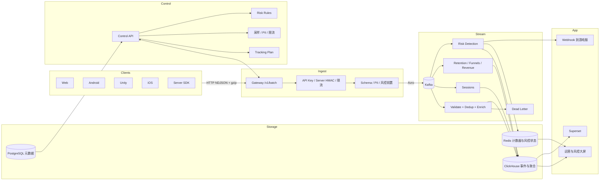

# Oddsmaker All-Java Architecture (Single Company, Multiple Games)

Goal: provide a real-time analytics and risk-control platform for multiple games and multiple environments inside one game company. The company is the deployment boundary; no multi-company shared multi-tenant SaaS.

## Overview



## Core Boundaries

- Company: deployment-level configuration, not part of the event partition key.
- Game: the core business object. The current implementation uses shared ClickHouse tables partitioned by `(game_id, environment)`; "a dedicated database per game" is a planned isolation form, expressed by the storage profile's `isolationStrategy` (`SHARED` / `PROD_ISOLATED` / `DEDICATED`); physical database splitting is not yet wired up.
- Environment: `dev`, `staging`, `prod` (plus `TESTING` and `LOADTEST`); isolated within tables by `environment` partition.
- API key: bound to `game_id + environment`, validating that event ownership is consistent.
- Permissions: bound to global, game, or environment scope.
- Risk-control policy: bound to `game_id + environment`.

**Current database layout (implemented):**

```
PostgreSQL（元数据）
├─ games / environments / api_keys
├─ users / roles / user_role_assignments
├─ tracking_plans / risk_rules / risk_cases / risk_features / block_lists
└─ audit_logs / storage_profiles ...

ClickHouse（事件与聚合，共享表）
├─ events / sessions
├─ retention / funnels
├─ risk_events / risk_scores / risk_actions
└─ （全部按 (game_id, environment, 日期) 分区）
（risk_cases 是 PostgreSQL 表，记录案例与判定状态机：OPEN → REVIEW/ALERT/MARK → THROTTLE/BLOCK → RESOLVED，分层前向单向流转）
```

The storage profile is the only bridge between a game and its storage: `SHARED` uses shared tables; `PROD_ISOLATED`/`DEDICATED` are reserved for dedicated-database forms.

Recommended default topology:

- `dev/staging` share a non-production ClickHouse cluster
- `prod` uses the production ClickHouse cluster
- Single-game failure impact and scaling are controlled by partition pruning and profile policy

## Data Model

Core event fields:

- Identity: `event_id,event_type,event_name` (`game_id` and `environment` are both storage fields and partition keys)
- Contract v2: `event_version,source,trust_level,event_origin` (authoritatively backfilled by the gateway; see the Ingestion API doc)
- User identity: `device_id,user_id,player_id,character_id,session_id`
- Time: `ts_client,ts_server,event_date`
- Client: `platform,app_version,sdk_version,country,user_agent`
- Game: `server_id,guild_id,match_id,level_id,game_mode,difficulty`
- Monetization: `order_id,product_id,revenue_amount,revenue_currency,receipt_hash`
- Virtual economy: `resource_id,resource_amount,flow_type,item_id`
- Advertising: `ad_network,ad_placement,ad_format,ad_impression_id`
- Risk: `risk_context` (`client_integrity,device_fingerprint` are contract-only fields (Avro), not persisted to the ClickHouse events table)
- Extension: `props_json,experiments,attribution`

ClickHouse partitioning (shared tables):

```sql
-- events
PARTITION BY (game_id, environment, toYYYYMM(event_date))
ORDER BY (game_id, environment, event_type, event_date, player_id, user_id, device_id, ts_server, event_id)
```

## Key Design

- Idempotent deduplication: the client generates `event_id`; the gateway claims the idempotency slot after schema validation to absorb SDK retries (counted as `duplicates`); Flink deduplicates by the logical event identity `game_id + environment + event_id` (state TTL 7 days, duplicates go to the DLQ).
- Out-of-order handling: Flink uses event time and watermarks; late events enter the compensation path.
- Schema governance: the Tracking Plan governs event names, field dictionaries, enums, and cardinality limits.
- Client safety: clients hold only the public `api_key`; HMAC is used only by the Server SDK.
- PII governance: the gateway enforces deny/mask/coarse; violating events go to the DLQ.
- Risk-control pipeline: hard blocking at the gateway, real-time detection in Flink, retrospective analysis in ClickHouse, and remediation output via Webhook.
- Risk feature layer: the risk-job feature branch aggregates the first 6 features over sliding windows (gold_gain_1h/24h, device_count, account_count_per_ip, win_rate, event_count_10m) and upserts into PostgreSQL `risk_features`; `FEATURE` rules read values from the feature snapshot to match (three-stage decoupling: event → feature → rule).
- Data isolation: shared tables are partitioned by `(game_id, environment)` + queries must carry the partition condition; physical database splitting is reserved by the storage profile's `isolationStrategy` and not yet wired up.

## Risk-Control Capabilities

Risk-control inputs:

- IP, UA, API key, signature, time window.
- Device fingerprint, emulator, Root/Jailbreak, debugger.
- Login, payment, ads, levels, resource flow, match results.

Risk-control outputs:

- `risk_events`: fact table of each rule hit.
- `risk_features`: window feature layer (PostgreSQL), the value source for `FEATURE` rules.
- `risk_scores`: cumulative risk score per subject (single writer on the risk-job evaluation side: accumulates the max contribution score per rule for each subject, with the rule-trigger detail JSON alongside; remediation actions are not written back).
- `risk_actions`: archive of remediation actions such as block, review, mark, throttle, webhook (judgment-type actions carry `risk_case_id`; illegal judgment transitions are archived as `decision_rejected`).

## Components and Languages

- Java 21
- Spring Boot 4 (gateway WebFlux / control plane Web MVC)
- Kafka 3
- Flink 1.19
- ClickHouse 24
- PostgreSQL
- Redis
- Avro / JSON Schema / Apicurio Registry
- OpenTelemetry + Prometheus + Grafana

## Directory

- `schema/`: Avro/JSON Schema, ClickHouse DDL
- `libs/`: shared models, authentication, Kafka, OTel
- `services/gateway-service/`: ingestion entry point
- `services/control-service/`: games, environments, keys, policies, risk control, permissions
- `jobs/flink/`: enrichment, session, retention, funnel, risk, and other jobs
- `sdks/`: Web, Android, iOS, Unity, Server
- `bi/`: Superset resources
- `infra/`: local and deployment orchestration
- `docs/`: architecture, API, operations, roadmap

## Source-Layer Analysis

The 2026-11-07 source-layer analysis defines 20 abstract layers by responsibility, not by directory name. Each layer's evidence is at the current HEAD `0c0141b`. See the [source-layer glossary](/reference/source-layer-glossary) for the term table.

| Layer | Responsibility | Representative code |
|---|---|---|
| SDK Client | Buffer, retry queue, identity/event ID generation, POST to `/v1/batch` | `sdks/web/src/index.ts:107`, `sdks/unity/Runtime/Oddsmaker.cs:139` |
| Gateway Ingress | Auth, rate limit, schema validation, PII sanitize, idempotency, sampling, block, Avro publish/DLQ | `services/gateway-service/.../BatchController.java:98`, `services/gateway-service/.../DlqPublisher.java:41` |
| Message Transport | Kafka topics + Apicurio Avro serialization | `docker-compose.quickstart.yml:93`, `services/gateway-service/.../AvroPublisher.java:72` |
| Stream Processing | Seven Flink 1.19 jobs consume `events_raw` → ClickHouse/PG/Kafka | `jobs/flink/events-enrich-job/.../EventsEnrichJob.java:97`, `jobs/flink/risk-job/.../RiskJob.java:148` |
| Analytics Storage | ClickHouse events/sessions/retention/funnels/identities/dimensions/risk aggregates | `schema/sql/clickhouse/schema.sql:4`, `schema/sql/clickhouse/analytics.sql:10` |
| Metadata and Control | 80 JPA entities in PostgreSQL, API surface, Flyway, ClickHouse queries | `services/control-service/.../Application.java:8`, `services/control-service/.../ClickHouseClient.java:37` |
| Control Consumer | Kafka listeners: risk cases/blocks/webhooks, identity links, DQ counters | `services/control-service/.../RiskEventConsumer.java:85`, `services/control-service/.../IdentityConsumer.java:56` |
| Scheduling and Background | Scheduled reconcile: retention, alerts, exports/erasure, webhook retry, Flink status, ML trainer | `services/control-service/.../RetentionEnforcementService.java:160`, `services/control-service/.../MLModelService.java:927` |
| ML Training | Python feature engineering → churn/PLTV/risk/propensity models → versioned JSON artifacts | `ml/oddsmaker_ml/cli.py:33`, `ml/oddsmaker_ml/artifact.py:25` |
| Dimension Sync | Agent polls CSV/Excel/JDBC/Kafka; control HTTP-pulls; Flink writes dimensions | `agents/dimension-sync-agent/.../AgentMain.java:104`, `jobs/flink/dimension-sync-job/.../DimensionSyncJob.java:110` |
| Observability and Ops | Prometheus/OTel/Grafana/compose/helm lifecycle | `infra/prometheus.yml:14`, `infra/otel-collector.yaml:12` |
| Web Console | Vue SPA: JWT auth state, routes, ~120 axios endpoints | `web/src/main.js:5`, `web/src/stores/auth.js:24`, `web/src/services/api.js:3` |
| Shared Common | Event model, HMAC, Kafka producer, OTel init in Gradle libs | `libs/common-model/.../Event.java:1`, `libs/common-auth/.../HmacSigner.java:1` |
| Single-Company Boundary | Company is deployment metadata; `game_id + environment` is logical boundary | `services/control-service/.../application.yaml:80`, `services/control-service/.../GameEntity.java:1` |
| Storage Routing | `storage_profile` targets + isolation strategy; only CRUD/default wired | `services/control-service/.../StorageProfileEntity.java:30`, `services/control-service/.../StorageProfileService.java:45` |
| Gateway Idempotency State | In-memory API-key context; instance-local TTL maps; Redis is future work | `services/gateway-service/.../AuthService.java:109`, `services/gateway-service/.../ReplayGuard.java:90` |
| Flink Processing State | Keyed ValueState, session windows, TTL, checkpoint; no external backend yet | `jobs/flink/events-enrich-job/.../EventsEnrichJob.java:88`, `jobs/flink/sessions-job/.../SessionsJob.java:97` |
| Control-plane Rule Cache | RiskJob polls active rules into in-process atomic map | `jobs/flink/risk-job/.../RuleFetcher.java:78`, `jobs/flink/risk-job/.../RuleConfig.java:46` |
| File Export and Agent State | Control export directory; agent JSON checkpoints; Unity persistent queues | `services/control-service/.../PlayerExportService.java:83`, `agents/dimension-sync-agent/.../CheckpointStore.java:34` |
| Observability Data State | Gateway in-memory quality counters → 60s snapshot to control | `services/gateway-service/.../DataQualityReporter.java:42`, `services/control-service/.../InternalDataQualityController.java:1` |

### Implementation, Configuration, and Protocol

- Gateway config: `services/gateway-service/src/main/resources/application.yaml`; Avro/JSON schema in `schema/avro/*.avsc`, `schema/json/*.json`, and `services/gateway-service/src/main/resources/schemas/`.
- Control config: `services/control-service/src/main/resources/application.yaml`; experiment config JSON in `services/control-service/src/main/resources/schemas/experiment-config.schema.json`.
- Flink jobs: each job has its own `build.gradle.kts`; Kafka/Apicurio settings come from compose environment (`docker-compose.yml:283`).
- SDK protocol: `/v1/batch` is defined by `schema/json/oddsmaker-event-schema.json`; SDK docs in `docs/reference/sdk-design.md`.
- Ops: `infra/prometheus.yml`, `infra/otel-collector.yaml`, `infra/helm/oddsmaker/templates/configmap.yaml`.

### Why These Layers Are Separate

1. SDKs and gateway have different failure/retry semantics: clients hold local queues and retry, the gateway must be stateless for ingestion (`sdks/web/src/index.ts:107`, `services/gateway-service/.../BatchController.java:98`).
2. Auth and schema validation run before any persistence, so the gateway can reject without touching Kafka (`services/gateway-service/.../BatchController.java:156`, `services/gateway-service/.../DlqPublisher.java:41`).
3. Transport is decoupled from business logic: producers/consumers only deal with Avro records (`services/gateway-service/.../AvroPublisher.java:72`, `jobs/flink/risk-job/.../RiskJob.java:148`).
4. Flink jobs are independently scalable and restartable, so stream state is keyed and checkpointed (`jobs/flink/events-enrich-job/.../EventsEnrichJob.java:88`).
5. ClickHouse is optimized for analytical scans; control-plane metadata in PostgreSQL is OLTP (`schema/sql/clickhouse/schema.sql:4`, `services/control-service/.../Application.java:8`).
6. Control-plane API is the single source of truth for configuration, kept separate from ingestion data path (`services/control-service/.../ClickHouseClient.java:37`, `services/control-service/.../application.yaml:33`).
7. Consumers handle side effects (cases, links, DQ) independently so a consumer failure does not block ingestion (`services/control-service/.../RiskEventConsumer.java:85`, `services/control-service/.../IdentityConsumer.java:56`).
8. Scheduled work is batch-oriented and idempotent; it must not run in the request path (`services/control-service/.../RetentionEnforcementService.java:160`).
9. ML is a separate process (Python) with its own artifact lifecycle, invoked asynchronously (`ml/oddsmaker_ml/cli.py:33`, `ml/oddsmaker_ml/artifact.py:25`).
10. Dimension sync is a different data source than events, so it has a dedicated agent and job (`agents/dimension-sync-agent/.../AgentMain.java:104`, `jobs/flink/dimension-sync-job/.../DimensionSyncJob.java:110`).
11. Observability is cross-cutting and defined by deployment files, not application code (`infra/prometheus.yml:14`, `infra/otel-collector.yaml:12`).
12. Web console is a separate runtime (browser) with no direct data access; all state flows through control API (`web/src/main.js:5`, `web/src/services/api.js:3`).
13. Shared libs avoid duplicating model/auth/transport across gateway, services, jobs (`libs/common-model/.../Event.java:1`, `libs/common-auth/.../HmacSigner.java:1`).
14. Storage routing is an explicit indirection so future per-game isolation does not require rewriting ingest (`services/control-service/.../StorageProfileEntity.java:30`, `services/control-service/.../StorageProfileService.java:45`).
15. Idempotency and rule caching are process-local to keep hot paths fast, with Redis explicitly deferred (`services/gateway-service/.../ReplayGuard.java:90`, `jobs/flink/risk-job/.../RuleFetcher.java:78`).

## Evolution Order

1. Per-game database architecture (not implemented): current shared tables are partitioned by `(game_id, environment)`; the dedicated-database form goes through the storage profile's `isolationStrategy`.
2. Wire up the single-company, multi-game control plane.
3. Extend game events v1.
4. Add risk-control rules, real-time detection, and remediation linkage.
5. Improve LTV, advertising, experiments, crash, and prediction models.
