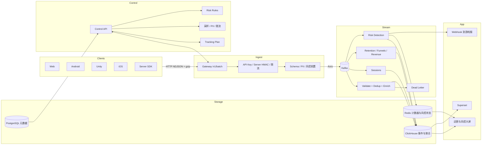

# Oddsmaker All-Java Architecture (Single Company, Multiple Games)

Goal: provide a real-time analytics and risk-control platform for multiple games and multiple environments inside one game company. The company is the deployment boundary; no multi-company shared multi-tenant SaaS.

## Overview



## Core Boundaries

- Company: deployment-level configuration, not part of the event partition key.
- Game: the core business object. The current implementation uses shared ClickHouse tables partitioned by `(game_id, environment)`; "a dedicated database per game" is a planned isolation form, expressed by the storage profile's `isolationStrategy` (`SHARED` / `PROD_ISOLATED` / `DEDICATED`); physical database splitting is not yet wired up.
- Environment: `dev`, `staging`, `prod` (plus `TESTING` and `LOADTEST`); isolated within tables by `environment` partition.
- API key: bound to `game_id + environment`, validating that event ownership is consistent.
- Permissions: bound to global, game, or environment scope.
- Risk-control policy: bound to `game_id + environment`.

**Current database layout (implemented):**

```
PostgreSQL（元数据）
├─ games / environments / api_keys
├─ users / roles / user_role_assignments
├─ tracking_plans / risk_rules / risk_cases / risk_features / block_lists
└─ audit_logs / storage_profiles ...

ClickHouse（事件与聚合，共享表）
├─ events / sessions
├─ retention / funnels
├─ risk_events / risk_scores / risk_actions
└─ （全部按 (game_id, environment, 日期) 分区）
（risk_cases 是 PostgreSQL 表，记录案例与判定状态机：OPEN → REVIEW/ALERT/MARK → THROTTLE/BLOCK → RESOLVED，分层前向单向流转）
```

The storage profile is the only bridge between a game and its storage: `SHARED` uses shared tables; `PROD_ISOLATED`/`DEDICATED` are reserved for dedicated-database forms.

Recommended default topology:

- `dev/staging` share a non-production ClickHouse cluster
- `prod` uses the production ClickHouse cluster
- Single-game failure impact and scaling are controlled by partition pruning and profile policy

## Data Model

Core event fields:

- Identity: `event_id,event_type,event_name` (`game_id` and `environment` are both storage fields and partition keys)
- Contract v2: `event_version,source,trust_level,event_origin` (authoritatively backfilled by the gateway; see the Ingestion API doc)
- User identity: `device_id,user_id,player_id,character_id,session_id`
- Time: `ts_client,ts_server,event_date`
- Client: `platform,app_version,sdk_version,country,user_agent`
- Game: `server_id,guild_id,match_id,level_id,game_mode,difficulty`
- Monetization: `order_id,product_id,revenue_amount,revenue_currency,receipt_hash`
- Virtual economy: `resource_id,resource_amount,flow_type,item_id`
- Advertising: `ad_network,ad_placement,ad_format,ad_impression_id`
- Risk: `risk_context` (`client_integrity,device_fingerprint` are contract-only fields (Avro), not persisted to the ClickHouse events table)
- Extension: `props_json,experiments,attribution`

ClickHouse partitioning (shared tables):

```sql
-- events
PARTITION BY (game_id, environment, toYYYYMM(event_date))
ORDER BY (game_id, environment, event_type, event_date, player_id, user_id, device_id, ts_server, event_id)
```

## Key Design

- Idempotent deduplication: the client generates `event_id`; the gateway claims the idempotency slot after schema validation to absorb SDK retries (counted as `duplicates`); Flink deduplicates by `event_id` (state TTL 7 days, duplicates go to the DLQ).
- Out-of-order handling: Flink uses event time and watermarks; late events enter the compensation path.
- Schema governance: the Tracking Plan governs event names, field dictionaries, enums, and cardinality limits.
- Client safety: clients hold only the public `api_key`; HMAC is used only by the Server SDK.
- PII governance: the gateway enforces deny/mask/coarse; violating events go to the DLQ.
- Risk-control pipeline: hard blocking at the gateway, real-time detection in Flink, retrospective analysis in ClickHouse, and remediation output via Webhook.
- Risk feature layer: the risk-job feature branch aggregates the first 6 features over sliding windows (gold_gain_1h/24h, device_count, account_count_per_ip, win_rate, event_count_10m) and upserts into PostgreSQL `risk_features`; `FEATURE` rules read values from the feature snapshot to match (three-stage decoupling: event → feature → rule).
- Data isolation: shared tables are partitioned by `(game_id, environment)` + queries must carry the partition condition; physical database splitting is reserved by the storage profile's `isolationStrategy` and not yet wired up.

## Risk-Control Capabilities

Risk-control inputs:

- IP, UA, API key, signature, time window.
- Device fingerprint, emulator, Root/Jailbreak, debugger.
- Login, payment, ads, levels, resource flow, match results.

Risk-control outputs:

- `risk_events`: fact table of each rule hit.
- `risk_features`: window feature layer (PostgreSQL), the value source for `FEATURE` rules.
- `risk_scores`: cumulative risk score per subject (single writer on the risk-job evaluation side: accumulates the max contribution score per rule for each subject, with the rule-trigger detail JSON alongside; remediation actions are not written back).
- `risk_actions`: archive of remediation actions such as block, review, mark, throttle, webhook (judgment-type actions carry `risk_case_id`; illegal judgment transitions are archived as `decision_rejected`).

## Components and Languages

- Java 21
- Spring Boot 4 (gateway WebFlux / control plane Web MVC)
- Kafka 3
- Flink 1.19
- ClickHouse 24
- PostgreSQL
- Redis
- Avro / JSON Schema / Apicurio Registry
- OpenTelemetry + Prometheus + Grafana

## Directory

- `schema/`: Avro/JSON Schema, ClickHouse DDL
- `libs/`: shared models, authentication, Kafka, OTel
- `services/gateway-service/`: ingestion entry point
- `services/control-service/`: games, environments, keys, policies, risk control, permissions
- `jobs/flink/`: enrichment, session, retention, funnel, risk, and other jobs
- `sdks/`: Web, Android, iOS, Unity, Server
- `bi/`: Superset resources
- `infra/`: local and deployment orchestration
- `docs/`: architecture, API, operations, roadmap

## Evolution Order

1. Per-game database architecture (not implemented): current shared tables are partitioned by `(game_id, environment)`; the dedicated-database form goes through the storage profile's `isolationStrategy`.
2. Wire up the single-company, multi-game control plane.
3. Extend game events v1.
4. Add risk-control rules, real-time detection, and remediation linkage.
5. Improve LTV, advertising, experiments, crash, and prediction models.
