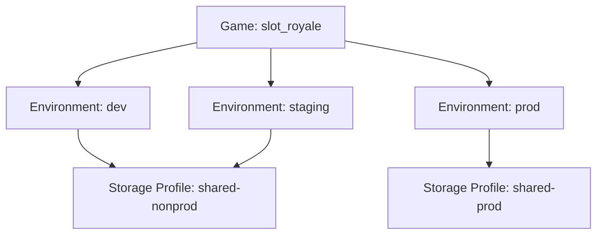
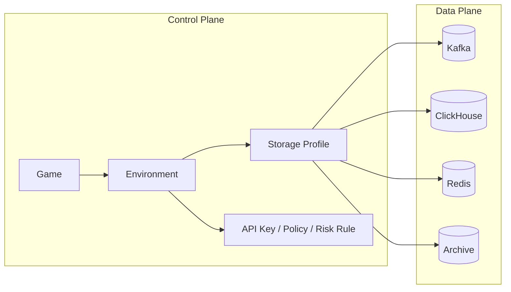

# Environment and Storage Profile Design

Oddsmaker's goal is not to build a multi-tenant SaaS that "looks sophisticated", but to provide **a single game company** with a genuinely operable multi-game analytics and risk control platform.

This means the model must satisfy three things at once:

- Multiple games can be managed within the same company
- The same game can go through release stages such as `dev / staging / prod`
- Data of different games can be isolated as needed (shared partitions → production isolation → dedicated backends)

> **Implementation status (2026-10)**: what is currently in place is shared ClickHouse tables, isolated by `(game_id, environment)` partitioning; "a separate database per game" is the target form, via the storage profile's `isolationStrategy`, and the physical database split is not yet wired up. The remaining sections of this document are written in terms of the target form; keep this note in mind when reading.

The design orientation is:

`Game -> Environment -> StorageProfile` (isolation strength is determined by the profile)

**Storage layout of the current implementation**:

```
PostgreSQL（元数据）
├─ games / environments / api_keys
├─ users / audit_logs / storage_profiles
└─ ...

ClickHouse（共享表）
├─ events / sessions / retention
├─ risk_events / risk_scores / risk_actions
└─ （全部按 (game_id, environment, 日期) 分区）
```

**Advantages of the target form (database per game)**:

- Physical isolation, with independent capacity planning and scaling
- Easier game migration and archival
- Queries can omit `WHERE game_id = ...` (current shared-table queries must carry the partition condition)

## Why Not Remove Environment

`environment`'s responsibility is to express the **release stage**, not the company, customer, or physical storage boundary.

Reasons to keep `environment`:

- The same game usually has different API Keys, sampling rates, PII policies, and risk thresholds under `dev/staging/prod`
- Risk rules are usually validated in non-production environments first, then promoted to production
- Test data and production data must be isolated, but the control plane should not have to replicate three sets of "fake games" for this
- SDKs, Gateway, Tracking Plan, experiments, and auditing naturally all need environment semantics

If `environment` were removed, things would usually end up degrading into:

- `game-a-dev`
- `game-a-staging`
- `game-a-prod`

The surface benefit of this design is simplicity, but the actual costs are:

- Duplicated control plane objects
- Duplicated rules and policies
- Duplicated API Key management
- Fragmented reporting and audit chains

## Evolution of the Storage Profile's Responsibilities

`storage_profile` is the only bridge between games/environments and the data plane:

- Describes the cluster configuration of Kafka / ClickHouse / Redis / archive buckets
- Expresses isolation strength via `isolationStrategy` (`SHARED` / `PROD_ISOLATED` / `DEDICATED`)—`SHARED` is the current default and the only wired-up form
- Handles cluster capacity planning and scaling

**storage_profile focuses on**:

- Kafka cluster configuration and topic namespace
- ClickHouse cluster configuration and database distribution
- Redis cluster configuration
- S3 Archive bucket configuration
- Cluster-level monitoring and alerting

## Core Model

### 1. Game

Business object.

Examples:

- `game_id = slot_royale`
- `game_id = poker_arena`

### 2. Environment

Logical release stage.

Recommended fixed enum:

- `dev`
- `qa`
- `staging`
- `prod`
- `loadtest`

Currently created by default:

- `dev`
- `staging`
- `prod`

### 3. StorageProfile

Data plane routing configuration.

It describes:

- Kafka cluster / topic namespace
- ClickHouse cluster / database routing
- Redis cluster
- Archive bucket
- Isolation strategy

## Recommended Strategies

Oddsmaker does not support unlimited custom isolation modes; instead it recommends a small number of controlled strategies.

### `SHARED`

All environments share the same set of backends.

Suitable for:

- Local development
- Demos
- Small-scale PoCs

Pros:

- Lowest cost
- Simplest deployment

Cons:

- Weak isolation between production and testing

### `PROD_ISOLATED`

`prod` uses a dedicated profile; `dev/qa/staging` share a non-production profile.

Suitable for:

- The default setup for normal production

Pros:

- Avoids test data polluting production
- Best balance of cost and isolation

Cons:

- One more set of backend resources than `SHARED`

### `DEDICATED`

A specific `game + environment` exclusively occupies a backend.

Suitable for:

- Top-tier games
- High-traffic production environments
- Strongly regulated or high-risk businesses

Pros:

- Strongest isolation
- Easy to scale independently

Cons:

- Highest cost and operational complexity

## Recommended Defaults

Oddsmaker recommends:

- Non-production: `shared-nonprod`
- Production: `shared-prod`
- Exceptionally large games: upgrade to `dedicated` as needed

In other words, the platform's recommended default is neither "share everything" nor "isolate everything", but:

**Production isolated, non-production shared.**

## Diagrams

### Logical Model



### Data Plane Mapping



## Design Benefits

### For the Analytics Pipeline

- The event protocol keeps `game_id + environment`
- No need to expose the storage topology to SDKs
- ClickHouse / Kafka / Redis can evolve per profile

### For the Risk Control Pipeline

- Risk rules remain bound to `game + environment`
- Production environments can be stricter, non-production can be looser
- Production Redis risk state can be independent, avoiding test pollution

### For the Control Plane

- No need to replicate three sets of "fake projects"
- More natural policy inheritance: game-level defaults, environment-level overrides
- Dedicated profiles can be added later without breaking the upper-level resource model

## Rejected Alternatives

### Option 1: Remove environment

Reasons for rejection:

- It would stuff release-stage semantics into game/project names
- API Keys, rules, audits, and experiments would be duplicated heavily

### Option 2: A separate database by default for every `(game, env)`

Reasons for rejection:

- Operational cost is too high
- Too much duplication of analytics objects, DDL, reports, and monitoring
- Too heavy for a project in its early days

## Final Conclusion

Oddsmaker's recommended model is:

- `game_id` handles business isolation
- `environment` handles stage isolation
- `storage_profile` is the configuration slot for isolation strength (currently only `SHARED` is wired up)

This model is more realistic than "keeping only game", and more operable than "splitting a separate database for every environment".
