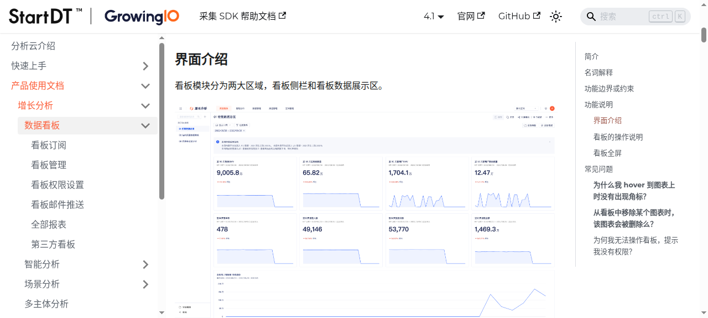
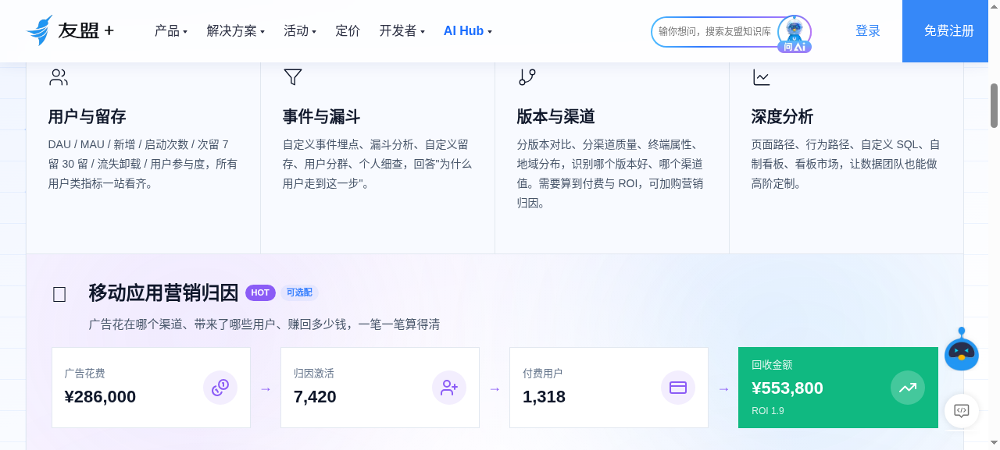
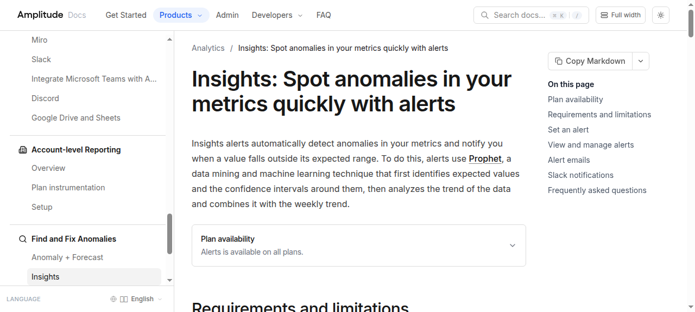
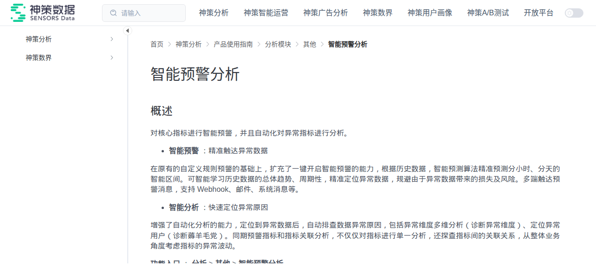
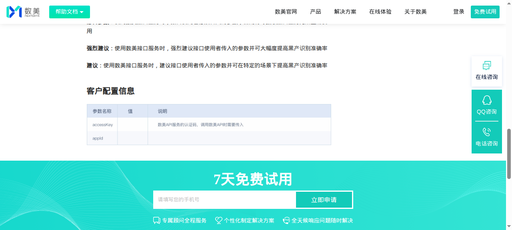
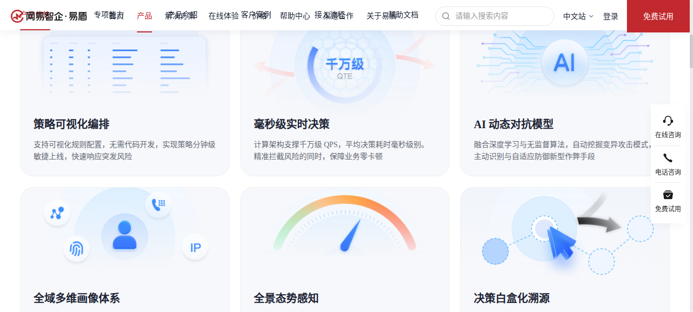
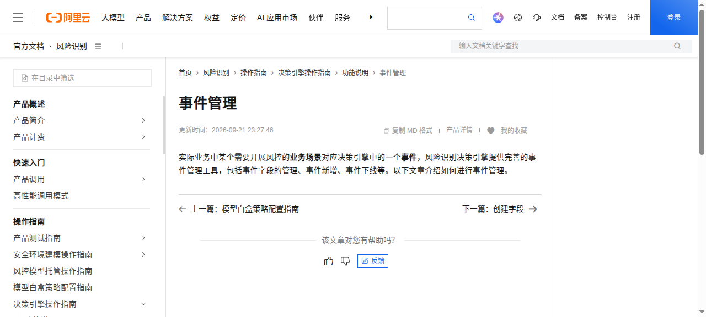
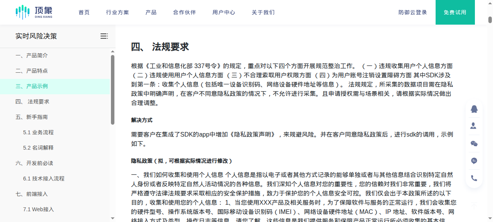

# Survey of Mature Analytics and Risk-Control Products (Features, Interactions, SDKs)

> Survey date: 2026-10 ｜ Method: each product's official documentation and product pages on their sites + GitHub repos (protocols and open-source status) + developer-center download pages; page screenshots captured 2026-10-08, sources in §8
> Covers 14 vendors: 10 analytics (GameAnalytics, Unity Analytics, Adjust, AppsFlyer, Firebase Analytics, Amplitude, 友盟+, TalkingData, 神策, GrowingIO), 4 risk control (数美, 网易易盾, 阿里云风险识别, 顶象)
> Purpose of the conclusions: to supplement the two areas not covered by `docs/competitive-analysis.md` (the capability gap matrix for 5 competitors) and `docs/mmp-attribution-evaluation.md` (the MMP data channel): **the concrete practices of UI interactions** and **SDK landing forms (integration approach, reporting protocol, platform coverage, open-source status)**

## 1. Survey Subjects and Scope

> **Conclusion:** 14 vendors = 10 analytics + 4 risk control; the material is limited to the two previously unexplored dimensions, "UI interactions" and "SDK landing forms"; the capability gap matrix is in `competitive-analysis.md`, the MMP data channel in `mmp-attribution-evaluation.md`, and the three documents complement each other.

| Product | Vendor | Form | Pricing | Focus of this document |
|------|------|------|----------|------------|
| GameAnalytics | GameAnalytics | Game analytics SaaS | Primarily free, paid for value-added features | Game-native event categorization, Collection API |
| Unity Analytics (UGS) | Unity | Engine-embedded analytics | Metered with UGS usage | UPM package integration, Legacy version retirement |
| Adjust | Adjust | MMP attribution | Paid | Open-source SDK, attribution and anti-fraud console |
| AppsFlyer | AppsFlyer | MMP attribution | Free tier + paid | Custom-licensed SDK, data export |
| Firebase Analytics | Google | Mobile analytics | Free + metered | DebugView, open-source boundaries, reporting format |
| Amplitude | Amplitude | Product analytics | Free tier + paid | Open-source SDK, chart-level alert configuration |
| 友盟+ U-App | 友盟同欣 (Alibaba-affiliated) | Mobile analytics | Free + paid | HarmonyOS/mini-game platform coverage, alert plans |
| TalkingData | TalkingData | Mobile analytics + ad monitoring | Paid | Download-based Native SDK, partially open-source wrapper layer |
| 神策数据 | 神策 | Analytics + private deployment | Paid | Platform-differentiated open-source policy, smart-alert interactions |
| GrowingIO | GrowingIO | Tracking-free analytics | Paid | Full-tracking SDK, dashboards and subscription interactions |
| 数美 | 北京数美时代 | Risk control + content moderation | Paid | Regional cluster reporting, decision engine console |
| 网易易盾 | 网易智企 | Intelligent risk control | Paid | Visual strategy orchestration, console download-based SDK |
| 阿里云风险识别 | 阿里云 | Risk control platform | Metered + model billing | Decision engine (event→variable→strategy) |
| 顶象 | 顶象 | Real-time risk decision | Paid, private deployment supported | Device fingerprint token chain, frontend SDK lineage |

Scope note: this document only states facts that can be found in public documentation; vendor docs are revised at any time, and anything not found is marked "not public" — no inference is made. The old Alibaba Cloud "data risk control" docs (2016/2017 PDFs) and the "data risk control" built into WAF (Bot protection) are two different things; this document covers only the current "Risk Identification" product.

## 2. Analytics: Features and Interactions

### 2.1 Dashboards and Analysis Entries

> **Conclusion:** analytics dashboards are generally two-tiered — "preset overview + composable analysis modules" — and the differences concentrate in entry organization — Amplitude attaches alerts to charts, 神策 reuses bookmarks, GrowingIO offers global filtering and two-level sharing.

| Product | Dashboard form | Funnel/retention entries | One interaction worth noting |
|------|----------|---------------|------------------|
| GameAnalytics | Preset Overview (real-time) + analysis modules | Funnel, retention, progression | The eight standard event types (Ad/Business/Design/Error/Health/Impression/Progression/Resource) are categorized at collection time, and the dashboard groups by event type |
| Unity Analytics | UGS Dashboard embedded in the game services console | Funnel, engagement views | The legacy Unity Analytics was already marked Legacy in the 2022.3 manual and is taken over by the UGS Analytics SDK |
| Adjust | Console organized by "attribution—validation—analysis" | Cohort, event reports | Traffic validation and fraud interception (Detections) sit at the same level as reports, not a separate security product entry |
| AppsFlyer | Dashboard + integration center + data export | Event reports, audiences | The raw data export (Push API / Data Locker / Raw Data Pull) is an independent top-level entry in the console, on par with reports |
| Firebase Analytics | GA4 home cards + Realtime + Explore | Funnels and audiences embedded in Realtime cards | DebugView: every event fired from a connected debug device is visible in real time; integration verification depends on it |
| Amplitude | Chart → Dashboard, two levels | Event segmentation, funnel, retention, paths | The bell icon in the top-right corner of a chart directly opens "Set Alert"; alerts bind to charts rather than a separate configuration page |
| 友盟+ U-App | Home dashboard + deep analysis | Funnel, custom retention, user segments | Deep analysis includes custom SQL and custom dashboards, plus a dashboard marketplace (on the site's product page) |
| TalkingData | Site documentation focuses on SDK integration | Little public documentation of the analytics UI | This document draws no conclusions about its analytics UI |
| 神策 | Dashboard + analysis models (event/funnel/retention) + persona | Analysis models have their own entry and can be saved as bookmarks | Bookmarks are the smallest reusable unit of analysis results: alerts can be created directly from an existing bookmark |
| GrowingIO | Dashboard = a collection of charts; the dashboard is the login landing page | Funnel steps are draggable, retention tables can be drilled down into segments | Dashboards have global filtering and time filtering (applying to every chart on the board); sharing has two levels ("viewer/editor"), and fullscreen supports dark mode and minute-level scheduled refresh |

Figure: dashboard form comparison between two vendors (友盟 is a public product-page image, GrowingIO is the official manual's UI description):

### 2.2 Alert Configuration Interfaces

> **Conclusion:** alerts are the area where vendors differ most, but the convergence direction is consistent — configuration entries stay close to the data, beyond the threshold tiers every vendor keeps a "system auto-detects anomalies" tier, and notification channels converge to the trio of webhook + email + IM.

Alerts are the area of greatest divergence, four approaches:

1. **Amplitude: alerts attached to charts, three tiers of automation.** automatic (monitors every event by default, enabled only when volume ≥100/day and data present on ≥15 of the last 30 days; anything outside the 99% confidence interval counts as anomalous; 120-day training period), smart (99% confidence interval), custom (above/below a specified value, rate of change, 95%/98%/99% confidence). The entry point is the chart bell icon; trigger records go to Notifications → Alerts; training takes 120 days at day granularity and 14 days at hour granularity; the free tier gets 1 alert, the Plus tier gets 2.

   

2. **神策: alerts are an independent module, but their metrics come from event analysis.** Path "Analysis > Other > Intelligent Alert Analysis"; when creating, you can jump from a bookmark to event analysis to build the metric. Three notification channels: system messages (checked by default), enterprise-group webhooks (飞书/钉钉/企业微信), and email (with "test send"). After a trigger, smart analysis runs automatically: layered localization of anomalous dimensions, anomalous user localization (subject defaults to Distinct ID and IP, up to 5 event attributes can be added), and overlap ranking of alert metrics across the same period. Separately, "Platform Management > Ops Management > Alert Management" handles channels and history; a single rule can be configured with up to three notification methods. Screenshot below.

   
3. **友盟: alerts configure conditions as "plans", channels tied to domestic IM**. U-APM's new alert plan lets you check "ignored errors do not participate in trigger-condition computation", with conditions of the form "new and cumulative error count / affected user count reaches y in the past n minutes"; channels cover email, DingTalk, 飞书, and WeCom.
4. **Firebase / GA4: anomaly detection is computed by the system; users only subscribe**. Analytics Intelligence gives an expected range based on historical patterns, and anything outside it is anomalous; users configure alerts on custom cards (Custom Insights) without having to set thresholds themselves.

Common ground: notification channels all converge to the trio of "webhook + email + in-product/IM"; threshold alerts and anomaly detection are built separately — no one wants users to fill in every threshold by hand.

### 2.3 Risk Control: Rule Engine Interfaces

> **Conclusion:** the four risk-control consoles are isomorphic as "event → field/variable → strategy → decision", the same shape as this repo's Gateway-fronted + Flink real-time rule chain; the genuinely scarce items are the review entries — Alibaba Cloud's sample management/strategy lab and 数美's false-positive/false-negative case review.

| Product | Console layering | What you can see on screen |
|------|------------|------------------|
| 数美 | Device fingerprint → real-time blockable events → account risk results → WEB console | The decision-engine console supports configuring variables, strategies, and users, and supports false-positive/false-negative case analysis; strategy templates cover preset scenarios, 10+ operators, with external feature ingestion and strategy canary, A/B, and champion-challenger support |
| 网易易盾 | Risk engine → service management (SDK downloads live here) | The product page explicitly lists "visual strategy orchestration" (low-code rule configuration, minute-level go-live), millisecond-level real-time decisions, panoramic situational awareness, and white-box decision tracing; see the comparison screenshots below |
| 阿里云风险识别 | Decision engine → field management / event management / variable management / strategy management / strategy lab / analysis center | Official four-step flow: create event → associate variables (simple variables, complex variables, lists, cumulative metrics) → strategy editing (multiple strategies per event, multiple conditions per strategy) → call the API; also sample management and model white-box strategy configuration; see the comparison screenshots below |
| 顶象 | Application management → real-time risk decision / device fingerprint | In the docs, "fields" are the minimal unit for judging risk (ID, IP, account, device fingerprint), and both metric and strategy configuration are built on fields; the device-collection monitoring module can query details by device fingerprint, source, token, risk label, IP, and request time |

The shared shape across all four is **event → field/variable → strategy → decision**, isomorphic to this repo's Gateway-fronted + Flink real-time rule chain; the difference is that Alibaba Cloud makes "sample management and strategy lab" a first-class citizen while 数美 puts "false-positive/false-negative case analysis" on the console homepage — these two are the easiest to be missing when doing reviews.

Console screenshots across the four vendors:

## 3. SDKs: Integration Approach, Reporting Protocol, Platform Coverage, Open-Source Status

### 3.1 Analytics SDKs

> **Conclusion:** all analytics SDKs have dual channels of "client + server"; only overseas vendors publish their reporting protocols (GA Collection API, Amplitude HTTP V2) — domestic vendors and the risk-control category are all closed-source; the same vendor's license can differ by platform, so the specific repository's LICENSE file must be checked before adoption.

| Product | Integration approach | Reporting protocol | Platform coverage | Open-source status |
|------|----------|----------|--------|----------|
| GameAnalytics | Client SDK, or the server calls the Collection API directly | HTTPS `POST /v2/{game_key}/init` and `/v2/{game_key}/events`, batch JSON; SDK and server share the same API, and the interfaces carry signatures | Unity, GameMaker, Construct, Stencyl, Android, iOS, JavaScript, C# (Mono/UWP), Flutter (official pub package) | SDK repositories sit under the GitHub `GameAnalytics` org (114 repos), mostly MIT |
| Unity Analytics | UPM package `com.unity.services.analytics`, or direct server upload via the Collect API | HTTPS collection endpoints (Collect API docs at services.docs.unity.com) | Unity ecosystem, Editor minimum 2022.3 (per UGS Release Notes) | Distributed as a UPM package; the only publicly visible artifact is the needle-mirror read-only mirror |
| Adjust | Client SDK + S2S event interface | The client SDK connects over HTTPS directly to Adjust's collection endpoints; S2S is pushed by the business backend | Android, iOS, Unity, Flutter, React Native, Cordova, Xamarin, etc. | GitHub `adjust/android_sdk` and other repos are public, and Maven Central is marked **MIT** |
| AppsFlyer | Client SDK (`initSDK(devKey, appID)`) + server API | The SDK reports encrypted to AppsFlyer's collection endpoints; external data goes through Push API / Data Locker / Raw Data Pull API | Native Android/iOS + Unity, React Native, Flutter, Cordova, WebView, etc. | The GitHub `AppsFlyerSDK` org repos are public, but the LICENSE is the **AppsFlyer SDK custom service terms**, not an OSI license |
| Firebase Analytics | Firebase SDK (`logEvent` etc.) + DebugView debugging | Goes through Google's logging API; community packet-capture conclusions are **iOS uses Protobuf, Android uses JSON** (TrackHAR issue #52) | Android, iOS, Web, Unity/C++, etc. | The `firebase-ios-sdk` repo is open source, but its README states **the FirebaseAnalytics library is not open source**; other platforms ship as prebuilt dependencies |
| Amplitude | Client SDK, or server-side HTTP V2 | HTTPS `POST` to `api2.amplitude.com` (HTTP V2, replacing the old HTTP API), batch JSON; also Ampli generative strongly-typed wrappers | Web/Node/Python/iOS/Android and mainstream cross-platform frameworks | Most repos under the GitHub `amplitude` org are **MIT** (e.g. `@amplitude/analytics-browser`) |
| 友盟+ U-App | Developer center downloads a binary SDK per platform; the AppKey identifies the app | Not described in public documentation | Android, iOS, HarmonyOS NEXT, Flutter, React Native, Unity3D, Cocos2dx-C++/lua, quick apps, WeChat/Alipay mini-programs, H5/Web, mini-games | The GitHub `umeng` org has official repos, and the major platforms ship as binary packages (jar/aar) + a package-name MD5 |
| TalkingData | The site's download center "customizes" and generates a Native SDK per platform, which the business side assembles | Not described in public documentation | Android, iOS, H5, WeChat mini-programs, plus uni-app/DCloud third-party plugins | Partially open source: the GitHub `TalkingData/TalkingDataSDK_Unity` repo exposes only the wrapper layer; the `.jar/.a` native libraries must be downloaded from the site |
| 神策 | Client SDK + server SDK + third-party integrations | The SDK reports to the 神策 analytics service (SaaS or private instance); the protocol is not elaborated in the public manual | Client: Android, iOS, Web JS, mini-programs, Flutter, RN, Weex, APICloud, uni-app, Unity, cocos2d-x, C++; server: Java, Python, C, C#, Golang, PHP, Ruby, Lua, Node | Differs by platform: `sa-sdk-android-plugin2` is marked Apache-2.0, while the `sa-sdk-unity` LICENSE is a custom "commercial use requires a purchased license" agreement |
| GrowingIO | Client SDK + server SDK; the project side must obtain AccountId/UrlScheme/ServerHost/DataSourceId | Reports to the configured ServerHost; encrypted transmission of collected data supported since 14.3.0 | Client: Android, Apple, Web JS, 9 mini-program platforms, HarmonyOS, RN, Flutter; server: Java, PHP, Python, Go, Ruby, Node | The GitHub `growingio` org is open source; the mini-program SDK README states it is "completely free and open source", while noting the open-source version **removes commercial features such as performance monitoring and vendor adaptation** |

### 3.2 Risk-Control SDKs

> **Conclusion:** no risk-control SDK is open source, and they all follow the download-after-login console model; the chain is uniformly dual-channel: "the device side collects device information in exchange for a token + the business backend calls the decision interface with the token".

| Product | Device side | Server side | Protocol and chain | Open-source status |
|------|------|--------|------------|----------|
| 数美 | Device fingerprint SDK `smsdk` (3.14.*, Android/iOS/HarmonyOS) | Event interfaces (register, login, order placement, withdrawal, etc.) | Clustered by data center; HTTPS reporting to `api-*`.fengkongcloud.com (e.g. Beijing `api-skynet-bj.fengkongcloud.com/v4/event`); standard integration (SaaS-hosted) and custom integration modes | Not open source; the SDK is obtained from 数美 |
| 网易易盾 | Android, iOS, mini-programs, WEB/WAP/H5, plus Windows (C#) on the game side | `check` interface | Frontend SDK collection + server-side check dual channel; game scenarios can go client-only | Not open source; download it after logging into the 易盾 console under "Risk Engine - Service Management", and the game side requires cooperating with a hardening tool |
| 阿里云风险识别 | Device risk SDK (docs include "Device Risk SDK Android Integration") | Primarily server-side APIs, with AccessKey signing | RPC/POP-style APIs + decision-engine event calls | Not open source |
| 顶象 | Web (JS, IE8+ and mainstream browsers, embedded WebView), Android (`DXRisk.java`), iOS (`DXRisk.xcframework` / `DXRiskWithIDFA`), WeChat/Alipay/Baidu/Douyin mini-programs, uniapp | Backend SDK download and integration | The device side collects device information and uploads it to the risk console in exchange for a token; the business backend calls the decision interface with the token | Not open source; supports rapid private deployment |

Three observations useful for this repo:

1. **Only the analytics vendors from overseas publish reporting protocols** (GameAnalytics's Collection API and Amplitude's HTTP V2 both have referenceable interface documentation); domestic analytics vendors and all risk-control vendors keep protocol details private, so integration can only follow the official SDK, with no reference for building a compatibility layer.
2. **Open-source degree ordering: analytics > risk control**. Risk-control vendors do not even offer public binary downloads (易盾, 数美, and 顶象 all distribute their SDKs from a console behind login), so the controllability of integrating them is inherently lower than analytics SDKs.
3. **The same vendor's license can fork**: 神策 distinguishes Apache-2.0 from commercial licenses by platform, GrowingIO's open-source version deliberately strips commercial modules, and AppsFlyer's repos are public but use custom terms. Whether something can be adopted directly depends on the specific repository's LICENSE file, not on the GitHub page being Public.

## 4. Practices in Interaction Design Worth Copying Directly

1. **Alert configuration stays next to the charts**: Amplitude's bell and 神策's "create alert from bookmark" both place the configuration entry next to data the user is already watching. The dedicated alert-management page keeps only enable/disable, history, and channels.
2. **Anomaly detection and threshold alerts take two separate paths**: GA4, 神策, and Amplitude all first provide a default "system auto-detects anomalies" tier, with the threshold tier as the advanced option. Alerts that only do thresholds leave users either missing incidents or deafened by noise.
3. **Notification channels are a fixed trio**: webhook, email, in-product/IM — consistent across vendors. 神策 centralizes channel configuration in one "Alert Management", where rules only pick the channel type, which is more convenient than configuring each rule individually.
4. **Risk-control consoles are layered as "event → field/variable → strategy"**, identical across all four; this repo's rule chain is already the same shape, 数美's false-positive/false-negative case review entry has been added (`/risk-cases` risk-case page), and Alibaba Cloud's review entry has landed in the form of a strategy lab (`/risk-lab` rule review aggregation + sample drill-down).
5. **The verification entry during integration decides retention**: Firebase DebugView, 友盟's "test feature to verify reporting accuracy", and GrowingIO's "data validation" are all written into the fixed steps of their integration docs, showing that every vendor considers "did the data arrive" the number-one question during integration (consistent with the first gap conclusion in §3 of `docs/competitive-analysis.md`).

## 5. Forms Explicitly Not Pursued

> **Conclusion:** the four forms each mark a boundary — distribution (console download model), collection (tracking-free), detection algorithm (ML anomaly detection deferred), product boundary (attribution: integrate only, don't build).

| Form | Source | Reasoning |
|------|------|------|
| Download-based/console-based SDK distribution (易盾, 数美, TalkingData) | The three risk-control vendors + TalkingData | Conflicts with the package-manager distribution model of this repo's sdks/ directory; integrating such external SDKs can only be an integration item, not entering the main repo |
| Tracking-free/full-tracking collection | GrowingIO, 神策 (some platforms) | Depends on bytecode instrumentation or full DOM listening, with a large client-side change surface and privacy surface; this repo follows explicit tracking + Tracking Plan governance |
| Automatic anomaly detection (Prophet/ML intervals) | Amplitude, GA4, 神策 | Requires historical baseline training and backfilling per metric, so it ranks after threshold alerts; building the alert configuration UI first is the better trade |
| Attribution and anti-fraud as a main product | Adjust, AppsFlyer | Already settled in `docs/mmp-attribution-evaluation.md` as "consume data, not build a product"; this repo only consumes MMP attribution results |

## 6. Correspondence with This Repo's Current State

- Alerts: this repo already has threshold alerts; what's missing is "configuration entry next to charts" and a way to converge channels beyond webhook/email — §2.2 can serve as the interaction reference.
- Risk-control console: the rule-chain shape matches the four vendors; false-positive/false-negative case review has landed (`/risk-cases` risk-case page), and the strategy-lab review aggregation has landed (`/risk-lab`); "sample set upload + batch replay" was re-judged on 2026-10-10: dry-run replay lands in V0.3 (per-event scoring for THRESHOLD/FEATURE, streaming-window rule types explicitly marked as skipped), and sample-set persistence lands in V0.4 (named archiving / load-and-replay comparison).
- SDK: this repo's five-platform SDKs all report via JSON, and only the Server SDK adds an HMAC signature (client SDKs do not hold the signing key — by design); JSON reporting is the same form as GameAnalytics's Collection API and Amplitude's HTTP V2, and these two public protocols can serve as comparison baselines.
- Distribution: this repo's SDKs ship with the repository and package manager, not the risk vendors' console-download model — see §5 for the reasoning.

## 7. Reference Analysis (Per-Item Judgments and Landing Points)

> **Conclusion:** 12 judgments — 5 "reference" items all landed or partially landed (integration-period verification, risk layering, protocol baselines, alerts on charts all landed; channel convergence landed as webhook+email dual channels, with in-product IM staying long-term), 3 "worth borrowing" (false-positive/false-negative case review landed as the console `/risk-cases` risk-case page; strategy-lab review aggregation landed as `/risk-lab`; SDK same-form landed), 4 "not applicable" (download distribution, tracking-free collection, ML detection as a first release, in-house attribution — each with boundary reasoning; the latter two stay deferred, and the 2026-10-09 per-item decisions are in each row's landing point and the todo).

| Judgment | Reference item | Why | Landing point in this repo |
|------|--------|--------|----------|
| Reference | Alert configuration on charts (Amplitude bell, 神策 create-from-bookmark, §2.2) | Placing the configuration entry next to data the user is watching is a vendor-validated interaction; this repo's alerts currently have only a standalone page | Landed (chart-level entry): the alert bell next to the titles of the crash-trend and online-trend charts (`MetricAlertBell`, pre-filled metrics quick-create rules via the existing alert-rules API); rule enable/disable, history, and channels remain centralized in AlertsView — further converging "AlertsView keeps only enable/disable, history, and channels" is unnecessary for now; the current shape is the division of labor |
| Reference | Integration-period verification entry (Firebase DebugView, 友盟 test verification, GrowingIO data validation, §4.5) | "Did the data arrive" is the number-one question during integration and directly determines platform trust | Landed: Live Inspector (`/analytics/inspector`) shows per-event arrival and rejection reasons; the data health page (`/data-health`) shows the five rates and the identity (B10) |
| Reference | Notification channel trio convergence (webhook/email/in-product IM, §2.2) | Consistent across vendors, and channel configuration is centralized in one place with rules only picking channel types | Email channel landed: one recipient config per game (`alert_email_configs`, best-effort delivery on alert trigger, skipped when SMTP is not configured); configuration and test sends live on the business alert page; existing webhook (`notifyWebhook` → webhook_logs, with per-config timeout) + email as dual channels; in-product IM stays long-term (decided 2026-10-09: a message center with read/unread states is an entirely new product surface; webhook+email already cover offline reach, so it is a product-level new direction awaiting a decision) |
| Reference | Risk-control console "event→field→strategy" layering (§2.3) | Isomorphic across the four vendors, and this repo's Gateway-fronted + Flink real-time setup is already the same shape, so the layering is an existing consensus | Landed: `RiskRulesView` + B5 "event→feature→rule" three-stage decoupling (rule conditions take values from features) |
| Reference | Public reporting protocols as comparison baselines (GA Collection API, Amplitude HTTP V2, §3) | Referenceable public interface documentation exists, which can verify whether the repo's own protocol design drifts | Same form already (JSON reporting): of the five platforms, the Server SDK (B3) uses JSON+HMAC, and the other four use only x-api-key; the protocol docs use these two public APIs as comparison baselines |
| Worth borrowing | Sample management + strategy lab (Alibaba Cloud), false-positive/false-negative case review (数美, §2.3) | The first demand after a rule goes live is review, and this is the easiest area to be missing | Review has landed: the case APIs (`/api/games/{gameId}/risk-cases` list/details/unblock) + the console risk-case page (`/risk-cases`: filtering, evidence/context review, false-positive unblock with linked blocklist release); strategy lab landed in V0.2 (decided 2026-10-09): `GET /api/games/{gameId}/risk-lab/rule-stats` rule review aggregation (false-positive rate with denominator = dispositioned, average review duration, zero-case/orphan rule rows) + case-list `ruleId`/`disposition` sample drill-down + the console `/risk-lab` page; "sample set upload + batch replay scoring" was re-judged on 2026-10-10 as "do it": V0.3 dry-run replay (`POST /api/games/{gameId}/risk-lab/replay`, per-event scoring for THRESHOLD/FEATURE with semantics aligned to the online pure function; streaming-window types like FREQUENCY marked `needsStreaming` to explicitly skip without faking hits; same ruleType converges by riskScore; samples scored immediately without persistence), and sample-set persistence landed in V0.4 (`GET/POST /api/games/{gameId}/risk-lab/sample-sets` + `GET/DELETE .../{id}` + the console "sample sets" section: named archiving of 1–500 entries, write validation identical to dry-run, load-and-fill-back to change rules and compare replays, delete-and-recreate) |
| Worth borrowing | Anomaly detection default tier + threshold tier layering (GA4/神策/Amplitude, §4.2) | "System judges anomalies first, threshold tier as advanced" suppresses both missed reports and noise | `MetricAlertService` already has threshold + baseline comparison; Prophet/ML interval detection is deferred (consistent with §5 row 3) |
| Worth borrowing | Client SDK and server API on the same interface (GA Collection API, §3.1) | Server direct upload and client reporting share the API, halving the integration surface and giving a single verification reference | This repo's five-platform SDKs (including Server) already share this form; keep it and note it in the SDK docs |
| Not applicable | Download-based/console-based SDK distribution (易盾/数美/TalkingData, §5) | Conflicts with the package-manager distribution model of the sdks/ directory | External integration item only, not entering the main repo (§5 row 1) |
| Not applicable | Tracking-free/full-tracking collection (GrowingIO/神策 some platforms, §5) | Depends on instrumentation or full DOM listening, with a large client-side change surface and privacy surface | Keep explicit tracking + Tracking Plan governance (B7 EventSchema as a first-class resource) |
| Not applicable | Automatic anomaly detection as a first-release alert capability (§5) | Requires per-metric historical baseline training and backfilling, with costs paid upfront | Threshold alerts go first; ML detection stays scheduled for later evaluation and does not enter near-term batches (quantified trigger conditions re-judged on 2026-10-10 — meeting any one moves it into the evaluation batch: (a) metric history can be stably reviewed ≥ 7 days and 7d/28d quantile baselines are computable; (b) a single game's threshold alert rules are adjusted ≥ 3 times per month (verifiable in audit logs); (c) alert noise rate (share of reviews judged false positives) > 30% for 2 consecutive weeks; the 2026-10-09 decision was conditional triggering, not immediate work) |
| Not applicable | Attribution and anti-fraud as a main product (Adjust/AppsFlyer, §5) | Settled as "consume data, not build a product" | Only consume MMP attribution results — P8 paused (precondition: MMP raw data export permission); see `mmp-attribution-evaluation.md` for the finalized path |

## 8. Screenshot Index (Sources and Capture Time)

> **Conclusion:** all 8 screenshots are embedded inline in the corresponding sections (two each in §2.1 and §2.2, four in §2.3); this table holds only sources and copyright information.

All screenshots are third-party official pages, with copyright held by each vendor, for internal comparison reference only; captured 2026-10-08, in the `docs/research/assets/` directory.

| File | Source page | Captured content |
|------|----------|----------|
| `sensors-alert-config.png` | manual.sensorsdata.cn/sa/docs/guide_warning/v0300 | 神策 intelligent alert analysis page, with notification channels and smart-analysis descriptions |
| `growingio-dashboard.png` | docs.growingio.com/op-help/docs/4.1/product-manual/user-behavior-analytics/dashboards/ | GrowingIO data dashboard UI description (sidebar, single chart, global filtering, sharing) |
| `umeng-uapp-console.png` | www.umeng.com/pages/umeng-uapp | 友盟 U-App product page, with analysis modules and an ROI dashboard example |
| `amplitude-alerts.png` | amplitude.com/docs/analytics/insights | Amplitude alert (automatic/custom/smart) configuration docs |
| `yidun-risk-engine.png` | dun.163.com/product/risk-engine | 易盾 risk-engine product page, with capability cards such as visual strategy orchestration |
| `aliyun-decision-engine.png` | help.aliyun.com/zh/fraud-detection/user-guide/ | Alibaba Cloud Risk Identification decision-engine operation guide, with the left-side "Event Management/Create Field/Strategy Management" navigation |
| `shumei-decision-console.png` | help.ishumei.com/docs/tw/risk/api/ | 数美 transaction risk-control integration intro (including WEB console usage descriptions) |
| `dingxiang-risk-decision.png` | www.dingxiang-inc.com/docs/detail/ctu | 顶象 real-time risk decision docs, with the frontend integration platform list |

Products without screenshots (Unity, Firebase, Adjust, AppsFlyer, GameAnalytics, 神策's analytics UI, TalkingData) — because their consoles require login or their sites have no UI images; the relevant interaction descriptions follow the text documentation, with sources noted inline.

## 9. Source List

Analytics:
- GameAnalytics: docs.gameanalytics.com (Event Types, Collection API setup, per-platform SDK pages), the Collection API OpenAPI description on apis.io, the github.com/GameAnalytics org
- Unity: docs.unity3d.com (2022.2 manual Legacy Analytics, com.unity.services.analytics package API), services.docs.unity.com/analytics/v1 (Collect API), UGS Release Notes
- Adjust: dev.adjust.com (SDK integration guide), Maven Central `com.adjust.sdk:adjust-android` (MIT), github.com/adjust
- AppsFlyer: dev.appsflyer.com (API reference, initSDK), support.appsflyer.com (basic SDK integration guide), github.com/AppsFlyerSDK/AppsFlyerFramework LICENSE
- Firebase: firebase.google.com/docs/libraries and the firebase-ios-sdk README (FirebaseAnalytics is not open source), github.com/tweaselORG/TrackHAR#52 (packet-capture analysis of the reporting format), support.google.com/analytics (anomaly detection notes)
- Amplitude: amplitude.com/docs/analytics/insights (full alert docs, including Prophet, confidence intervals, training periods), amplitude.com/docs/apis/analytics/http-v2 (`api2.amplitude.com`), github.com/amplitude
- 友盟+: www.umeng.com/pages/umeng-uapp, devs.umeng.com (platform and SDK inventory), the developer.umeng.com alert-plan docs, github.com/umeng
- TalkingData: doc.talkingdata.com (SDK usage docs, data interfaces), github.com/TalkingData/TalkingDataSDK_Unity, www.talkingdata.com/safety.jsp (SDK compliance and security guide)
- 神策: manual.sensorsdata.cn (intelligent alert analysis, alert management, SDK feature overview), github.com/sensorsdata (including the sa-sdk-unity LICENSE)
- GrowingIO: growingio.github.io/growingio-sdk-docs (SDK overview and platform coverage), docs.growingio.com (data dashboards, funnels), the github.com/growingio/growingio-sdk-miniprogram-autotracker README

Risk control:
- 数美: help.ishumei.com (transaction risk-control integration intro, marketing risk-control cluster addresses, SDK privacy statement and smsdk versions), the www.ishumei.com decision-engine product page
- 网易易盾: dun.163.com/product/risk-engine, support.dun.163.com (intelligent risk-control integration steps and privacy notes)
- 阿里云: help.aliyun.com/zh/fraud-detection (product intro, decision-engine operation guide, event management), the Alibaba Cloud Risk Identification decision-engine PDF guide, and the Alibaba Cloud site's four-step "How to enable the risk identification decision engine"
- 顶象: www.dingxiang-inc.com/docs/detail/ctu (real-time risk decision) and const-id (device fingerprint), support.huaweicloud.com/dxbss-sag (顶象 business-security docs on Huawei Cloud, field and strategy configuration)
