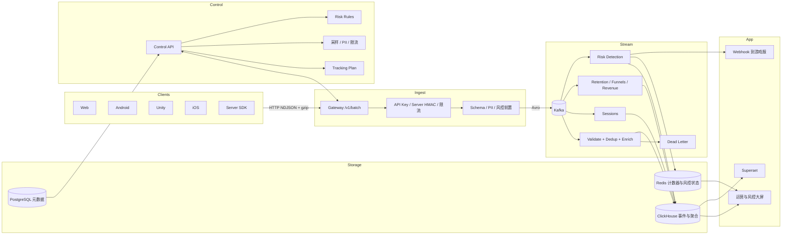

# Oddsmaker 全 Java 架构（单公司多游戏）

目标：为一个游戏公司内部提供多游戏、多环境的实时分析和风控平台。公司是部署边界，不做多公司共用的多租户 SaaS。

## 总览



## 核心边界

- 公司：部署级配置，不进入事件分区键。
- 游戏：核心业务对象。当前实现是共享 ClickHouse 表、按 `(game_id, environment)` 分区；「每个游戏独立数据库」是规划中的隔离形态，由存储 profile 的 `isolationStrategy`（`SHARED` / `PROD_ISOLATED` / `DEDICATED`）表达，物理分库尚未接线。
- 环境：`dev`、`staging`、`prod`（另有 `TESTING`、`LOADTEST` 两类），表内按 `environment` 分区隔离。
- API Key：绑定 `game_id + environment`，校验事件的归属一致。
- 权限：绑定全局、游戏或环境范围。
- 风控策略：绑定 `game_id + environment`。

**当前数据库布局（已实现）**：

```
PostgreSQL（元数据）
├─ games / environments / api_keys
├─ users / roles / user_role_assignments
├─ tracking_plans / risk_rules / risk_cases / risk_features / block_lists
└─ audit_logs / storage_profiles ...

ClickHouse（事件与聚合，共享表）
├─ events / sessions
├─ retention / funnels
├─ risk_events / risk_scores / risk_actions
└─ （全部按 (game_id, environment, 日期) 分区）
（risk_cases 是 PostgreSQL 表，记录案例与判定状态机：OPEN → REVIEW/ALERT/MARK → THROTTLE/BLOCK → RESOLVED，分层前向单向流转）
```

存储 profile 是游戏与存储之间的唯一桥：`SHARED` 用共享表，`PROD_ISOLATED`/`DEDICATED` 预留给独立库形态。

推荐默认拓扑：

- `dev/staging` 共享非生产 ClickHouse 集群
- `prod` 使用生产 ClickHouse 集群
- 单游戏故障影响与扩缩容靠分区裁剪与 profile 策略控制

## 数据模型

事件核心字段：

- 标识：`event_id,event_type,event_name`（`game_id`、`environment` 同时是存储字段和分区键）
- 契约 v2：`event_version,source,trust_level,event_origin`（网关权威回填，见采集 API 文档）
- 身份：`device_id,user_id,player_id,character_id,session_id`
- 时间：`ts_client,ts_server,event_date`
- 客户端：`platform,app_version,sdk_version,country,user_agent`
- 游戏：`server_id,guild_id,match_id,level_id,game_mode,difficulty`
- 商业化：`order_id,product_id,revenue_amount,revenue_currency,receipt_hash`
- 虚拟经济：`resource_id,resource_amount,flow_type,item_id`
- 广告：`ad_network,ad_placement,ad_format,ad_impression_id`
- 风控：`risk_context`（`client_integrity,device_fingerprint` 仅为契约字段（Avro），未落 ClickHouse events 表）
- 扩展：`props_json,experiments,attribution`

ClickHouse 分区（共享表）：

```sql
-- events
PARTITION BY (game_id, environment, toYYYYMM(event_date))
ORDER BY (game_id, environment, event_type, event_date, player_id, user_id, device_id, ts_server, event_id)
```

## 关键设计

- 幂等去重：客户端生成 `event_id`；Gateway 在 schema 校验通过后占用幂等位吸收 SDK 重试（计 `duplicates`）；Flink 按逻辑事件身份 `game_id + environment + event_id` 去重（状态 TTL 7 天，重复进 DLQ）。
- 乱序处理：Flink 使用事件时间和 watermark，迟到事件进入补偿链路。
- Schema 治理：Tracking Plan 管事件名、字段字典、枚举、cardinality 上限。
- 客户端安全：客户端只持 public `api_key`；HMAC 只用于 Server SDK。
- PII 治理：Gateway 执行 deny/mask/coarse，违规事件进入 DLQ。
- 风控链路：Gateway 硬拦截，Flink 实时检测，ClickHouse 回溯，Webhook 输出处置。
- 风控特征层：risk-job 特征作业分支按滑动窗口聚合首批 6 特征（gold_gain_1h/24h、device_count、account_count_per_ip、win_rate、event_count_10m），upsert PostgreSQL `risk_features`；`FEATURE` 规则从特征快照取值命中（事件→特征→规则三段解耦）。
- 数据隔离：共享表按 `(game_id, environment)` 分区 + 查询必带分区条件；物理分库由存储 profile 的 `isolationStrategy` 预留，尚未接线。

## 风控能力

风控输入：

- IP、UA、API Key、签名、时间窗。
- 设备指纹、模拟器、Root/Jailbreak、调试器。
- 登录、支付、广告、关卡、资源流、对局结果。

风控输出：

- `risk_events`：每次命中规则的事实表。
- `risk_features`：窗口特征层（PostgreSQL），`FEATURE` 规则的取值来源。
- `risk_scores`：主体累计风险评分（risk-job 评估侧单写：按主体累计各规则最大贡献分，规则触发明细 JSON 随行；处置动作不回写）。
- `risk_actions`：block、review、mark、throttle、webhook 等处置归档（判定型处置携带 risk_case_id；非法判定流转归档 decision_rejected）。

## 组件与语言

- Java 21
- Spring Boot 4（网关 WebFlux / 控制面 Web MVC）
- Kafka 3
- Flink 1.19
- ClickHouse 24
- PostgreSQL
- Redis
- Avro / JSON Schema / Apicurio Registry
- OpenTelemetry + Prometheus + Grafana

## 目录

- `schema/`：Avro/JSON Schema、ClickHouse DDL
- `libs/`：公共模型、鉴权、Kafka、OTel
- `services/gateway-service/`：采集入口
- `services/control-service/`：游戏、环境、密钥、策略、风控、权限
- `jobs/flink/`：富化、会话、留存、漏斗、风控等作业
- `sdks/`：Web、Android、iOS、Unity、Server
- `bi/`：Superset 资源
- `infra/`：本地和部署编排
- `docs/`：架构、API、运维、路线图

## 源码分层分析

2026-11-07 源码分层分析按职责（非目录名）归纳出 20 个抽象层，证据为审计时点采集的 `file:line` 引用；随代码演进行号可能漂移。术语表见[源码分层术语表](/zh/reference/source-layer-glossary)。

| 层 | 职责 | 代表代码 |
|---|---|---|
| 采集客户端层 | 本地缓冲/重试队列/身份与事件 ID 生成，POST `/v1/batch` | `sdks/web/src/index.ts:107` `sdks/unity/Runtime/Oddsmaker.cs:139` |
| 网关边缘接入层 | 认证、限流、schema 校验、PII 清洗、幂等、采样、封禁、Avro 发布/DLQ | `services/gateway-service/.../BatchController.java:98` `services/gateway-service/.../DlqPublisher.java:41` |
| 消息传输层 | Kafka topic + Apicurio Avro 序列化 | `docker-compose.quickstart.yml:93` `services/gateway-service/.../AvroPublisher.java:72` |
| 流处理层 | 七个 Flink 1.19 作业消费 `events_raw` → ClickHouse/PG/Kafka | `jobs/flink/events-enrich-job/.../EventsEnrichJob.java:97` `jobs/flink/risk-job/.../RiskJob.java:148` |
| 分析存储层 | ClickHouse 事件/会话/留存/漏斗/身份/维度/风控聚合 | `schema/sql/clickhouse/schema.sql:4` `schema/sql/clickhouse/analytics.sql:10` |
| 元数据与控制层 | PostgreSQL 82 个 JPA 实体、API 面、Flyway、ClickHouse 查询 | `services/control-service/.../Application.java:8` `services/control-service/.../ClickHouseClient.java:37` |
| 控制面消费层 | Kafka 监听：风控案例/封禁/webhook、身份关联、DQ 计数 | `services/control-service/.../RiskEventConsumer.java:85` `services/control-service/.../IdentityConsumer.java:56` |
| 调度与后台执行层 | 定时对账：保留、告警、导出/擦除、webhook 重试、Flink 状态、ML 训练 | `services/control-service/.../RetentionEnforcementService.java:160` `services/control-service/.../MLModelService.java:927` |
| ML 训练层 | Python 特征工程 → 流失/PLTV/风控/倾向模型 → 版本化 JSON 产物 | `ml/oddsmaker_ml/cli.py:33` `ml/oddsmaker_ml/artifact.py:25` |
| 维度同步层 | agent 轮询 CSV/Excel/JDBC/Kafka；control HTTP 拉取；Flink 写维度 | `agents/dimension-sync-agent/.../AgentMain.java:104` `jobs/flink/dimension-sync-job/.../DimensionSyncJob.java:110` |
| 观测与运维层 | Prometheus/OTel/Grafana/compose/helm 生命周期 | `infra/prometheus.yml:14` `infra/otel-collector.yaml:12` |
| Web 控制台层 | Vue SPA：JWT 认证状态、路由、约 120 个 axios 端点 | `web/src/main.js:5` `web/src/stores/auth.js:24` `web/src/services/api.js:3` |
| 共享公共层 | Gradle 库：事件模型、HMAC、Kafka producer、OTel 初始化 | `libs/common-model/.../Event.java:1` `libs/common-auth/.../HmacSigner.java:1` |
| 单公司边界 | company 是部署元数据；`game_id + environment` 是逻辑边界 | `services/control-service/.../application.yaml:80` `services/control-service/.../GameEntity.java:1` |
| 存储路由 | `storage_profile` 目标 + 隔离策略；仅接通 CRUD/默认分配 | `services/control-service/.../StorageProfileEntity.java:30` `services/control-service/.../StorageProfileService.java:45` |
| 网关幂等状态 | 内存 API-key 上下文；实例本地 TTL map；Redis 为未来工作 | `services/gateway-service/.../AuthService.java:109` `services/gateway-service/.../ReplayGuard.java:90` |
| Flink 处理状态 | Keyed ValueState、会话窗口、TTL、checkpoint；尚无外部后端 | `jobs/flink/events-enrich-job/.../EventsEnrichJob.java:88` `jobs/flink/sessions-job/.../SessionsJob.java:97` |
| 控制面规则缓存 | RiskJob 轮询活动规则到进程内原子 map | `jobs/flink/risk-job/.../RuleFetcher.java:78` `jobs/flink/risk-job/.../RuleConfig.java:46` |
| 文件导出与代理状态 | control 导出目录；agent JSON checkpoint；Unity 持久队列 | `services/control-service/.../PlayerExportService.java:83` `agents/dimension-sync-agent/.../CheckpointStore.java:34` |
| 观测数据状态 | gateway 内存质量计数 → 60 秒快照到 control | `services/gateway-service/.../DataQualityReporter.java:42` `services/control-service/.../InternalDataQualityController.java:1` |

### 实现、配置与协议位置

- Gateway 配置：`services/gateway-service/src/main/resources/application.yaml`；Avro/JSON schema 在 `schema/avro/*.avsc`、`schema/json/*.json`、`services/gateway-service/src/main/resources/schemas/`。
- Control 配置：`services/control-service/src/main/resources/application.yaml`；实验配置 JSON 在 `services/control-service/src/main/resources/schemas/experiment-config.schema.json`。
- Flink 作业：各作业独立 `build.gradle.kts`；Kafka/Apicurio 设置来自 compose 环境（`docker-compose.yml:283`）。
- SDK 协议：`/v1/batch` 由 `schema/json/oddsmaker-event-schema.json` 定义；SDK 文档在 `docs/reference/sdk-design.md`。
- 运维：`infra/prometheus.yml`、`infra/otel-collector.yaml`、`infra/helm/oddsmaker/templates/configmap.yaml`。

### 拆分理由

1. SDK 与 gateway 失败/重试语义不同：客户端持有本地队列并重试，gateway 需保持采集无状态（`sdks/web/src/index.ts:107`、`services/gateway-service/.../BatchController.java:98`）。
2. 认证与 schema 校验在任何持久化前执行，gateway 可不触碰 Kafka 即拒绝（`services/gateway-service/.../BatchController.java:156`、`services/gateway-service/.../DlqPublisher.java:41`）。
3. 传输与业务逻辑解耦：生产者/消费者只处理 Avro 记录（`services/gateway-service/.../AvroPublisher.java:72`、`jobs/flink/risk-job/.../RiskJob.java:148`）。
4. Flink 作业可独立扩缩容与重启，流状态按 key 并 checkpoint（`jobs/flink/events-enrich-job/.../EventsEnrichJob.java:88`）。
5. ClickHouse 面向分析扫描；control 元数据在 PostgreSQL 为 OLTP（`schema/sql/clickhouse/schema.sql:4`、`services/control-service/.../Application.java:8`）。
6. Control API 是配置唯一权威，与采集数据路径分开（`services/control-service/.../ClickHouseClient.java:37`、`services/control-service/.../application.yaml:33`）。
7. 消费者独立处理副作用（案例、关联、DQ），消费失败不阻塞采集（`services/control-service/.../RiskEventConsumer.java:85`、`services/control-service/.../IdentityConsumer.java:56`）。
8. 定时工作面向批且幂等，不得进入请求路径（`services/control-service/.../RetentionEnforcementService.java:160`）。
9. ML 是独立进程（Python）且有自身产物生命周期，异步调用（`ml/oddsmaker_ml/cli.py:33`、`ml/oddsmaker_ml/artifact.py:25`）。
10. 维度同步数据源不同于事件，故有专门 agent 与作业（`agents/dimension-sync-agent/.../AgentMain.java:104`、`jobs/flink/dimension-sync-job/.../DimensionSyncJob.java:110`）。
11. 观测横切且由部署文件定义，而非应用代码（`infra/prometheus.yml:14`、`infra/otel-collector.yaml:12`）。
12. Web 控制台是独立运行时（浏览器）且无直接数据访问；全部状态经 control API（`web/src/main.js:5`、`web/src/services/api.js:3`）。
13. 公共库避免在 gateway/services/jobs 重复模型/认证/传输（`libs/common-model/.../Event.java:1`、`libs/common-auth/.../HmacSigner.java:1`）。
14. 存储路由是显式间接层，未来按游戏隔离无需重写采集（`services/control-service/.../StorageProfileEntity.java:30`、`services/control-service/.../StorageProfileService.java:45`）。
15. 幂等与规则缓存保持进程本地以提速热路径，Redis 明确延后（`services/gateway-service/.../ReplayGuard.java:90`、`jobs/flink/risk-job/.../RuleFetcher.java:78`）。

## 演进顺序

1. 按游戏分库架构（未实现）：当前共享表按 `(game_id, environment)` 分区，独立库形态走存储 profile 的 `isolationStrategy`。
2. 接通单公司多游戏控制面。
3. 扩展游戏事件 v1。
4. 增加风控规则、实时检测和处置联动。
5. 完善 LTV、广告、实验、Crash 和预测模型。
