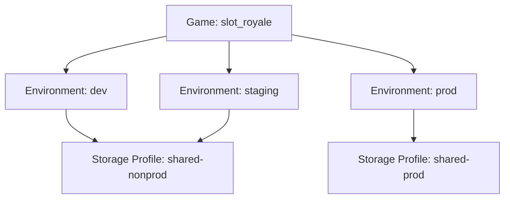
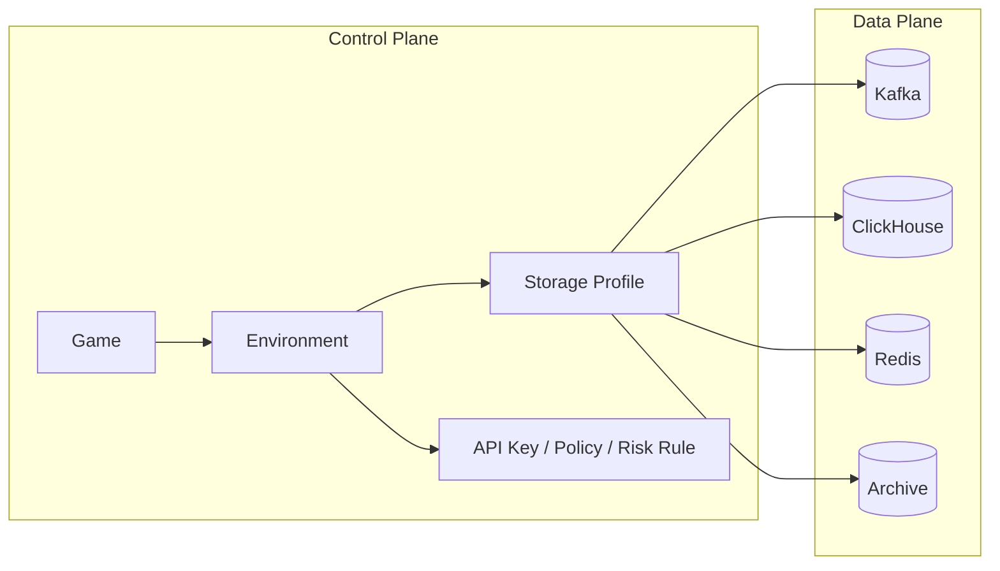

# Environment 与 Storage Profile 设计

> 🌐 Language: **中文** · English → [environment-and-storage.en.md](../../reference/environment-and-storage)

Oddsmaker 的目标不是做一个”看起来很高级”的多租户 SaaS，而是为**单个游戏公司**提供一套真实可运维的多游戏分析与风控平台。

这意味着模型必须同时满足三件事：

- 同一家公司内部可以管理多个游戏
- 同一个游戏可以经历 `dev / staging / prod` 等发布阶段
- 不同游戏的数据可以按需隔离（共享分区 → 生产隔离 → 独占后端）

> **实现状态（2026-10）**：当前落地的是共享 ClickHouse 表，按 `(game_id, environment)` 分区隔离；「每个游戏独立数据库」是目标形态，走存储 profile 的 `isolationStrategy`，物理分库尚未接线。本文其余小节按目标形态展开，阅读时对照此注。

设计取向是：

`Game -> Environment -> StorageProfile`（隔离强度由 profile 决定）

**当前实现的存储布局**：

```
PostgreSQL（元数据）
├─ games / environments / api_keys
├─ users / audit_logs / storage_profiles
└─ ...

ClickHouse（共享表）
├─ events / sessions / retention
├─ risk_events / risk_scores / risk_actions
└─ （全部按 (game_id, environment, 日期) 分区）
```

**目标形态（按游戏分库）的优势**：

- 物理隔离，独立容量规划与扩展
- 便于游戏迁移和归档
- 查询可以省去 `WHERE game_id = ...`（当前共享表查询必须带分区条件）

## 为什么不删除 Environment

`environment` 的职责是表达**发布阶段**，而不是表达公司、客户或存储物理边界。

保留 `environment` 的原因：

- 同一个游戏在 `dev/staging/prod` 下通常有不同 API Key、采样率、PII 策略和风控阈值
- 风控规则往往先在非生产环境验证，再进入生产
- 测试数据和生产数据必须隔离，但控制面不应为此复制成三套“假游戏”
- SDK、Gateway、Tracking Plan、实验和审计天然都需要环境语义

如果删除 `environment`，最终通常会退化成：

- `game-a-dev`
- `game-a-staging`
- `game-a-prod`

这种设计的表面好处是简单，但实际代价是：

- 控制面对象重复
- 规则和策略复制
- API Key 管理重复
- 报表与审计链路割裂

## Storage Profile 的职责演变

`storage_profile` 是游戏/环境与数据面之间的唯一桥：

- 描述 Kafka / ClickHouse / Redis / 归档桶的集群配置
- 用 `isolationStrategy`（`SHARED` / `PROD_ISOLATED` / `DEDICATED`）表达隔离强度——`SHARED` 是当前默认且唯一已接线的形态
- 负责集群的容量规划和扩容

**storage_profile 关注**：

- Kafka 集群配置和 topic 命名空间
- ClickHouse 集群配置和数据库分布
- Redis 集群配置
- S3 Archive bucket 配置
- 集群级别的监控和告警

## 核心模型

### 1. Game

业务对象。

示例：

- `game_id = slot_royale`
- `game_id = poker_arena`

### 2. Environment

逻辑发布阶段。

推荐固定枚举：

- `dev`
- `qa`
- `staging`
- `prod`
- `loadtest`

当前默认创建：

- `dev`
- `staging`
- `prod`

### 3. StorageProfile

数据面路由配置。

它描述的是：

- Kafka cluster / topic namespace
- ClickHouse cluster / database routing
- Redis cluster
- Archive bucket
- 隔离策略

## 推荐策略

Oddsmaker 不支持无限制自定义隔离模式，而是推荐少量受控策略。

### `SHARED`

所有环境共用同一套后端。

适用：

- 本地开发
- 演示
- 小规模 PoC

优点：

- 成本最低
- 部署最简单

缺点：

- 生产与测试隔离弱

### `PROD_ISOLATED`

`prod` 使用独立 profile，`dev/qa/staging` 共用非生产 profile。

适用：

- 正常生产默认方案

优点：

- 避免测试数据污染生产
- 成本和隔离的平衡最好

缺点：

- 比 `SHARED` 多一套后端资源

### `DEDICATED`

某个 `game + environment` 独占后端。

适用：

- 头部游戏
- 高流量生产环境
- 强合规或高风险业务

优点：

- 隔离最强
- 易于独立扩容

缺点：

- 成本和运维复杂度最高

## 推荐默认值

Oddsmaker 推荐：

- 非生产：`shared-nonprod`
- 生产：`shared-prod`
- 特殊大游戏：按需升级到 `dedicated`

也就是说，平台推荐默认不是“全部共享”，也不是“全部独立”，而是：

**生产独立，非生产共享。**

## 图示

### 逻辑模型



### 数据面映射



## 设计收益

### 对分析链路

- 事件协议继续保持 `game_id + environment`
- 不需要把存储拓扑暴露给 SDK
- ClickHouse / Kafka / Redis 可以按 profile 演进

### 对风控链路

- 风控规则仍绑定 `game + environment`
- 生产环境能更严格，非生产可更宽松
- 生产 Redis 风控状态可独立，避免测试污染

### 对控制面

- 不必复制三套“假项目”
- 策略继承更自然：游戏级默认，环境级覆盖
- 后续可扩展 dedicated profile，不破坏上层资源模型

## 不采用的方案

### 方案一：删除 environment

不采用原因：

- 会把发布阶段语义塞进 game/project 名字
- API Key、规则、审计、实验会大量复制

### 方案二：每个 `(game, env)` 默认独立数据库

不采用原因：

- 运维成本过高
- 分析对象、DDL、报表和监控复制过多
- 对创建初期的项目过重

## 最终结论

Oddsmaker 的推荐模型是：

- `game_id` 负责业务隔离
- `environment` 负责阶段隔离
- `storage_profile` 负责隔离强度的配置位（当前只有 `SHARED` 接线）

这套模型比“只保留 game”更真实，也比“每个环境都拆独立库”更可运维。

## 事件投递与去重语义（审计 DATA-001）

端到端链路 Kafka `events_raw` → events-enrich-job → ClickHouse `events` 的投递语义是
**at-least-once**——平台不承诺严格一次性，本节把残余重复窗口显式界定清楚。

### 逻辑事件身份与两道去重

逻辑事件身份 = `game_id + environment + event_id`，长度前缀编码（长度定界，杜绝分隔符撞键）。
两处同口径：

- 网关 `ReplayGuard`（Redis，入口幂等）——第一道，挡住采集端重发；
- 富化作业 `DedupFunction`（Flink keyed state，7 天 TTL）——第二道，挡住 Kafka 重投与
  重启重放。

### 去重作用域

作业侧去重只在算子的 **keyed state** 作用域内成立。keyed state 随 checkpoint 持久化，
只在 checkpoint 可恢复时才跨重启保留；仓内未配置外部 state backend 或 HA 管理器，
checkpoint 落在 JobManager 进程内。

### 残余重复窗口（未消除）

1. **checkpoint 不可恢复的重启**（compose local executor 形态：进程内 state backend、无 HA）
   → 去重 state 全空，重投的同 event_id 事件会再次入表；
2. **checkpoint 间隔窗口**（配置 `CheckpointingMode.AT_LEAST_ONCE` 时残留）→ JdbcSink 不等
   checkpoint 完成即刷盘；若刷盘后、checkpoint 完成前作业崩溃，恢复时 offset 回退重读这批
   事件，而去重 state 只回到上次 checkpoint（不含这批）→ 同 event_id 重复入表；
3. **sink 无事务** → JdbcSink 批量写入 + 重试（`maxRetries=3`）在 at-least-once 语义下可能
   重放已应用的部分行。

### 存储层与查询层都不收敛重复

`events` 是纯 `ENGINE = MergeTree`（ORDER BY 含 `event_id`，但无 `dedup_token`、非
ReplacingMergeTree），分析查询也未按 event_id 做 uniq/argMax 补偿——**重复行永久留表**，
AggregatingMergeTree 类聚合表随之重复计数。

### 当前决定

本批次不引入下游幂等写入：ReplacingMergeTree + `dedup_token` 需同时改造全部聚合表与读取
查询（`dedup` 修饰符、聚合口径变更），作为后续批次的独立改造，不并入本批次。当前边界 =
上游两道去重 + 显式声明残余窗口 + 观测，而非「重复已消除」。

### 观测口径

作业内被判重复的事件走 DLQ 侧输出（Kafka 文本主题，消息含 `duplicate` 标记）——DLQ 中的
duplicate 计数是「上游去重拦截量」的直接读数。注意它只是上界信号：**第 1 类窗口下重复会
直接入表且不留 DLQ 痕迹**，DLQ 静默不等于下游无重复。

### 验证面

- `EventsEnrichJobTest.dedupScopeIsJobStateOnly`：行为钉——空状态实例再投同一 event_id 会
  二次入 sink，把「去重只在状态作用域内」固化成可执行断言；
- `ClickhouseEventsDeliverySemanticsTest`：schema 钉（events 表无去重令牌，一旦改为分区去重
  引擎即打红）+ 文档对账钉（本节 at-least-once / keyed state / MergeTree / 残余 四个关键
  表述缺失即打红），防止残余风险在文档里被悄悄写成已消除。
